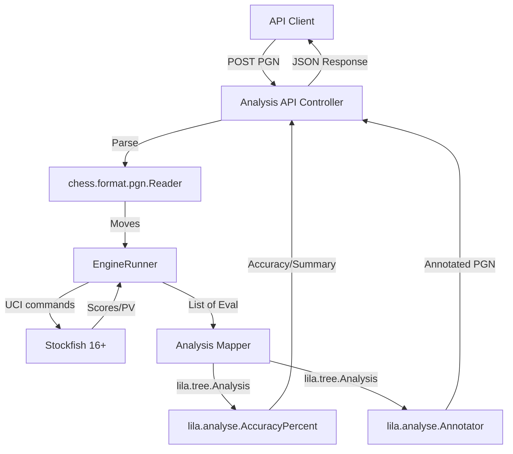

# Architecture Patterns: Lila Analysis API

**Domain:** Chess Analysis API
**Researched:** 2026-03-01
**Overall Confidence:** HIGH (Based on Lichess `modules/analyse` source code analysis)

## Recommended Architecture

The Lila Analysis API is designed as a **Specialized Service Layer** within the existing Lichess (`lila`) multi-module project. It leverages the "Stateless Analysis" pattern, decoupling core logic from the Lichess database (MongoDB) to ensure portability.

### Component Boundaries

| Component | Responsibility | Communicates With |
|-----------|---------------|-------------------|
| `modules/analysis-api` | API Entry point (Play/Akka-HTTP), PGN Parsing, Request Handling. | Client, `EngineRunner`, `lila.analyse` |
| `EngineRunner` | Orchestrates local Stockfish process via UCI; manages engine pools. | Stockfish CLI, `AnalysisService` |
| `modules/analyse` | **Logic Core**: Accuracy calculations (`AccuracyPercent`), Blunder/Brilliant detection. | `lila.tree` |
| `modules/tree` | **Data Models**: `Analysis`, `Advice`, `Info`, `Eval` structures. | `lila.analyse`, `modules/game` |
| `modules/game` | **Chess Rules**: PGN reading/writing, move validation, game state. | `lila-chess` (external lib) |

### Data Flow



1. **Input**: API receives a raw PGN.
2. **Parsing**: `modules/game` (relying on `lila-chess`) converts PGN into a list of move objects.
3. **Analysis**: `EngineRunner` iterates through moves, querying Stockfish for evaluation (CP/Mate) and Best Move (PV).
4. **Transform**: Engine output is mapped into `lila.tree.Info` and bundled into a `lila.tree.Analysis` object.
5. **Enrichment**:
    - `AccuracyPercent` calculates accuracy for both sides using the win-probability model.
    - `Annotator` inserts judgments (Blunder, Mistake) and variations into the PGN.
6. **Output**: Resulting metrics and the annotated PGN are returned to the client.

## Patterns to Follow

### Pattern 1: Stateless Logic Injection
**What:** Pass the `Analysis` object directly to logic components rather than relying on `GameRepo` or database IDs.
**When:** For any API endpoint to ensure portability.
**Example:**
```scala
// Do NOT do this (requires DB)
def getAccuracy(gameId: String) = gameRepo.byId(gameId).flatMap(analyser.get)

// DO this (Stateless)
val analysis = Analysis(infos = engineEvals)
val accuracy = AccuracyPercent.gameAccuracy(startColor, analysis)
```

### Pattern 2: Multi-Module Packaging
**What:** Define a new SBT project in `build.sbt` that depends on specific modules but uses `sbt-native-packager` to produce a standalone executable.
**Why:** Allows the API to be deployed as a microservice while living in the main repo.

## Build Order Implications

To maintain a healthy build graph and ensure `analysis-api` remains portable:

1. **Level 1-3 (Core)**: `core`, `common`, `tree` (Foundational models).
2. **Level 4-5 (Domain)**: `game`, `analyse` (Logic without DB dependency if used correctly).
3. **New Module**: `analysis-api` (Depends on `analyse`, `game`, `tree`).

**Warning**: Avoid making `analysis-api` depend on `modules/api` or `modules/web` to prevent pulling in the entire Lichess web ecosystem (authentication, UI templates, etc.).

## Scalability Considerations

| Concern | At 100 req/day | At 10K req/day | At 1M req/day |
|---------|--------------|--------------|-------------|
| **Compute** | Single Stockfish process | Local engine pool | Distributed Workers (Fishnet style) |
| **Memory** | Minimal (1GB) | 4-8GB for engine hash | Caching of common positions |
| **Latency** | 1-2s per game | Parallelize ply analysis | Rate limiting + Queue system |

## Sources

- `modules/analyse/src/main/AccuracyPercent.scala` (Accuracy model)
- `modules/analyse/src/main/Annotator.scala` (PGN Annotation logic)
- `modules/tree/src/main/Analysis.scala` (Analysis data model)
- `build.sbt` (Module dependency structure)
